# Hexwright Atlas

A procedural, hand-drawn-style hex-map atlas. Give it a seed and it generates a fantasy realm
(terrain, rivers, roads, settlements, names) on a canvas, and lets you "enter" any city to see an
isometric district map.

## Moving between modules

A rail down the left edge (along the bottom on phones) holds every part of the app, on every page:

- **View:** **Atlas** (the realm map and its cities), **Scenes** (the bundled maps, each ready to open), **Tactical**
  and **Town** (the two play views, on the map editor's current map).
- **Make:** **Map editor** (the tile editor) and **Characters** (the character maker).
- **Data:** **Unit data** (`units.html`).

`Alt+1` to `Alt+7` jump straight to each. The module showing is kept in the address (`index.html#editor`,
`#tactical`, `#town`, `#characters`, `#scenes`), so a reload or a bookmark lands on it, and the rail on the unit
data page goes back to the atlas page with the module in the address. The back buttons inside each module still
step down one layer (tactical view to editor to atlas) and the rail follows them.

**Scenes** lists the maps in `scenes/` and the editor's walking-test fixture as cards, each with a picture drawn by
the editor's renderer, its size and figures, and what it is for. Its main button opens the map in the view it was
laid out for (the tactical view, the town view or the editor, from its `.scene.json`); **Edit map** opens it in
the editor instead. Opening a scene replaces the editor's map; **Undo** brings the previous one back.

## Tile editor

The **Map editor** in the rail opens an isometric workbench built on the same tile set as the city
districts. Paint 46 kinds of ground, raise and lower terrain, place buildings, props, plants, room pieces and furniture,
turn pieces (`R`) and the view (`[` `]`), give buildings interiors to furnish (`N`), undo with `Ctrl+Z`, and export PNG or JSON.

The palette's tabs (Terrain, Buildings, Props, Nature, Interior, Characters) list their pieces under categories:
the ground by its kinds (Ground, Water, Farm, Paved, Floors, Elven), and the pieces by what they are for:

| Tab | Categories |
| --- | --- |
| Buildings | Homes · Shops and trades · Farm · Faith · Walls and towers · Elven |
| Props | Farm and field · Street and harbour · Monuments · Camp and woodland · Elven |
| Nature | Trees · Bushes and cacti · Ground cover · Elven |
| Interior | Walls and stairs · On the walls · Tables and seats · Beds and storage · Tavern · Smithy · Alchemist · Household · Hall and chapel |

Under **Shops and trades** stand two shops of two tiles, drawn for the editor, the tactical view and the town view:
the **smithy**, a stone workshop under slate with its door at one end, a horseshoe over it and the anvil sign beside
it, the rest of its front an open forge bay on timber posts where the forge glows under its hood, tongs and hammers
hang on the sooty back wall and an anvil and a quenching barrel stand in the opening, a broad stack smoking over it;
and the **alchemist's shop**, two timbered storeys of lilac plaster under indigo slate, a painted door and a shop
window of glowing bottles on three shelves, herbs drying under the eave and in boxes under the upper windows, the flask
sign by the door, a round stone turret with a verdigris cone and a gold star at its far end, and fumes in pale greens
and violets from its chimney. (The small one-tile smithy is now the **forge hut**.)

A row of chips at the top of a long tab jumps to a category, and a category's heading folds it away (the folds are
remembered in the browser). The **find** box over the tabs (`/` to reach it, `Esc` to clear it) searches every tab
at once, by name, category and id, and lists what it finds under *Tab · Category*. The categories live in
`src/tiles/assets.js` (`ASSET_CATEGORIES`); a new piece no category names shows under **Other**, and the automation
API's `describe` gives each asset's `category`.

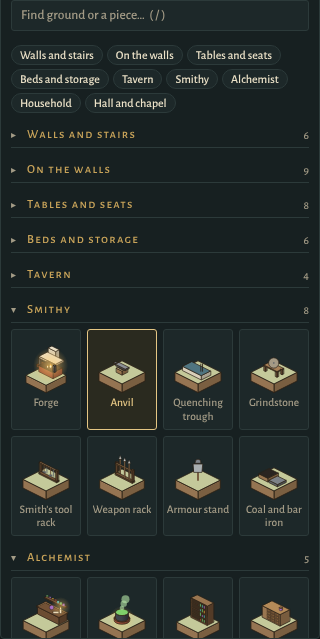

**Generate** builds a starting scene for one of six lands (river vale, island harbour, desert oasis, frozen fells,
fenland, ashlands). The land is kept calm: the main ground covers most of it with the others in a few broad patches,
heights rise in wide terraces, ponds, islets, plateaus and patches of only a few tiles are smoothed away, water
deepens with distance from the shore, and woods gather in groves with only the odd tree in the open. On the realm map, **Enter hex** in any hex's survey opens a tiled map of that hex,
generated from the atlas: its biome blended into its neighbours', coast or lake shore on the sides that touch
water, rivers and roads crossing the same sides as on the map, farmland, and the village, town, keep, ruin or
other feature that stands there (a city or abbey hex brings its whole city plan). Inside a city, **Enter
district** opens just the selected district. The map is autosaved in the browser.

### The elven wood

An elven tile set sits alongside the rest: its grounds under their own **Elven** heading in the Terrain tab, and its
pieces at the end of the Buildings, Props and Nature tabs. Everything is drawn for every view (the editor's map, the
tactical view's pixel art and the town view's front-on pieces), after one palette: white moonstone, verdigris copper,
silver bark, gold leaf, and a cool pale light where the town's lamps are warm.

- **Grounds:** elven moss starred with pale flowers, fallen gold leaves, moonstone paving laid in fish-scale courses
  with a gold leaf inlaid here and there, an ash floor inlaid with a gold vine, and a moonlit pool (water, rippling,
  with lily pads and motes of light).
- **Buildings,** in the high elven manner of Rivendell: tall pointed windows filled with stone tracery (a mullion
  branching in a Y under an oculus, a transom in the tallest, a gold hood-mould over each), roofs of verdigris that
  sweep down in a concave curve and flick up at the eaves under gold barge boards and leaf finials, slender columns
  and open arcades with tracery hung in their heads.
  - the **elven hall** (2×1): coursed moonstone, a pointed door under a tracery fanlight, a lit tracery window in
    its gable;
  - the **elven manor** (2×2): two storeys of tracery windows, a balcony with a balustrade of little arches across
    the upper floor, and a round turret on the corner under a needle of verdigris;
  - the **elven rotunda** (2×2): an arcade of pointed arches round a drum whose clerestory is ringed with tall
    tracery windows, under a ribbed dome, a lantern and a finial;
  - the **elven pavilion**: an open arcade on four slender columns, a lantern hung inside, an ogee roof;
  - the **elven archway**: two pillars and a pointed arch of moonstone with tracery in its head and lanterns hung
    from it, which characters walk through;
  - the **elven spire** (a slender white tower with a balcony ring and a needle of verdigris) and the **tree flet**
    (a round house on a railed platform high in a silver-barked tree, under its gold crown).
- **Nature:** the **mallorn** (silver bark, a gold crown), the **silver willow** (a dome of leaves with strands hanging
  nearly to the ground), and **moonflowers**.
- **Props:** the **elven lantern** (a teardrop of pale light hung from a silver crook) and the **moonwell** (a moonstone
  rim round glowing water under a carved arch).

In the town view (`src/town/elven.js`) each building has its own silhouette and its own carving, on one shared kit:
moonstone in long shallow courses (never brick), pilasters standing proud with gold caps and a shadow cast east, carved
friezes of running gold vine, roofs of verdigris scale tiles that sweep down and flick up at the eaves under a gold
ridge with a cresting of curls, concave gables with carved barge boards, a finial above and a pendant below, tracery
lights set back in their reveals, rose windows, carved double doors under a lit tympanum with steps before them,
lanterns hung from gold brackets, and ivy.

- **Hall:** a long hall behind a tall gabled porch with a rose window, buttresses between its lights, ivy up its west
  end, lanterns either side of the door; turned end on, one tall gable over its whole width.
- **Manor:** a steep gable front with a balcony on carved brackets before a triple light, a lower wing to the east and
  a round turret wound with ivy under a flared needle.
- **Rotunda:** a drum ringed with tall tracery between pilasters, an arcade opening on a lit floor, a ribbed dome of
  scales and an arcaded lantern.
- **Spire:** a tapering shaft of stacked lights on a stepped base, a balcony on corbels, a lit bell stage and a flared
  needle.
- **Pavilion:** columns wound with gold vine, a bench and a hanging lantern within, an onion roof with drops at its eave.
- **Archway:** clustered shafts and a pointed arch of voussoirs with a gold leaf trail, tracery in its head and lanterns
  hung beneath.
- **Flet:** a stair winding up the trunk to a railed platform, a round house of pale boards with a rose window under a
  swept roof, lanterns hung below.

Open pieces (the pavilion, the flet, the archway) cast a pool of shadow round their feet rather than a block, and the
others cast theirs east from their own outline.

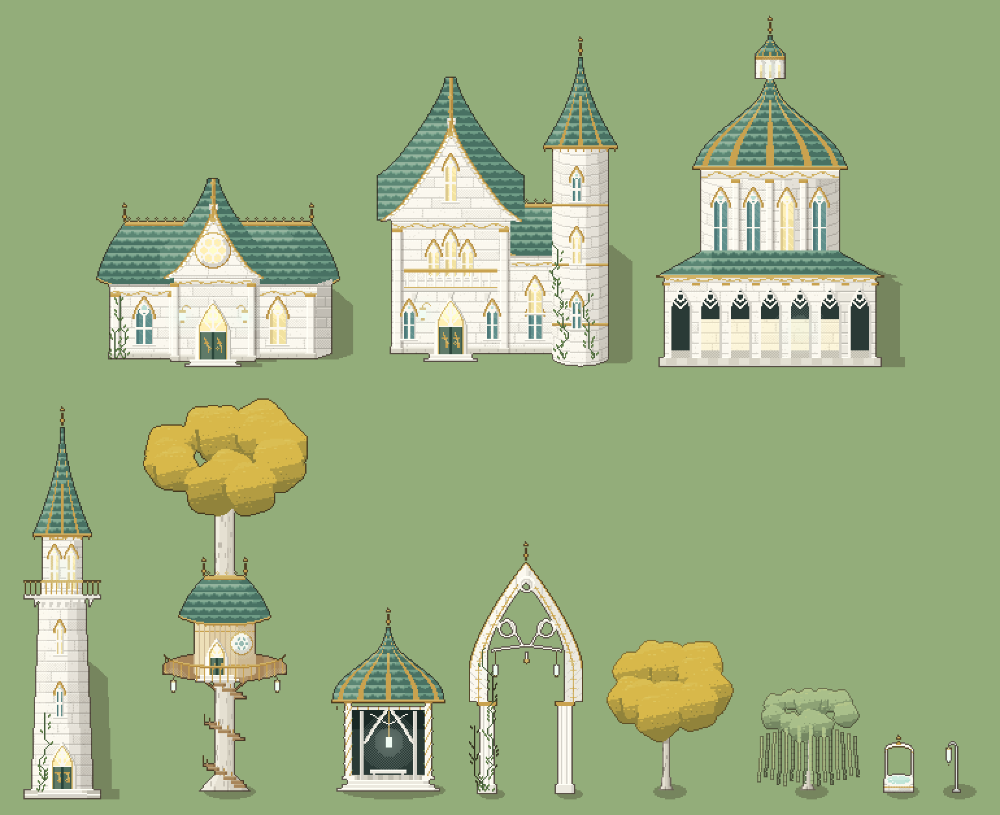

The elves who live there are in the roster (see [Characters](#characters)). The editor's drawings are in
`src/tiles/elven.js`, the tactical view's in `src/tactical/elven.js`, the town view's in `src/town/elven.js`, and the
grounds beside the others in each. `scenes/town/silverleaf-hollow.html` is an elven hollow built to show it all (see
[Test scenes](#test-scenes)).

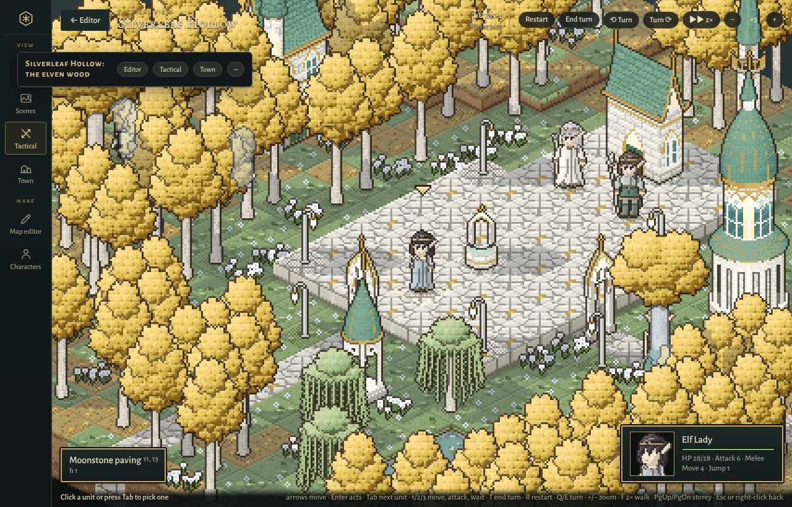

### Interiors

The **Interior** tab holds room pieces and furniture, and the Terrain tab has a **Floors** group (floorboards,
dark oak, stone, a chequered floor, red and blue carpet, strewn rushes).

- **Room pieces:** an interior wall, a wall with a window, a doorway, a fireplace, stairs, a timber post, and walls
  with something on them: a shelf of plates, antlers, a shield over crossed swords, a candle sconce, the back bar
  of a tavern (shelves of bottles over a cupboard, standing against the wall), a smith's rail of hammers and tongs, a
  shelf of potions, bunches of herbs hung to dry, or a star chart. Walls are
  kept low, cut away like a dolls' house so the room stays visible, and they join the room pieces beside them
  into corners and tees. Characters can walk through a doorway; every other piece blocks them.
- **Furniture:** a bed, a straw cot, a table, a long table, a chair, a stool, a bench, a chest, a wardrobe, a
  bookshelf, a dresser, a writing desk, a counter, a cooking pot, a wash tub, a candle stand, a potted plant, a
  throne, an altar, a pew, a weapon rack, a spinning wheel, a coat stand, grain sacks, firewood and a notice board;
  and for a tavern a bar counter, a table with chairs round it, a long table between benches, a back bar and a rack
  of ale casks. For a smithy: a forge (a brick hearth of glowing coals under a stone hood and flue, bellows beside
  it), an anvil on its stump, a quenching trough, a grindstone, a rack of smith's tools, an armour stand and a bin of
  coal with bar iron. For an alchemist: a workbench of apparatus (an alembic over its furnace, a retort on a spirit
  lamp, phials, a mortar, a grimoire, a shelf of jars over it), a bubbling cauldron of green brew, shelves of potions,
  a herb drying rack and a cabinet of apothecary drawers. Bar counter pieces join the ones beside them, as walls do, so a run of them makes one counter,
  straight or round a corner. Each is drawn in its own frame, so `R` turns it to face any of the four ways and
  turning the view shows its back; a bar counter faces the side its customers stand.

### Building interiors

Any building can be given an interior: a room of its own to furnish, which the town view lets the hero walk into.

- **Giving one:** the **Interior** tool (`N`) rings in gold every building that already has an interior. Click a
  building to give it one and open it, or to open the one it has. The city wall, the elven archway and the pavilion
  are open to the air, so they cannot have one.
- **The room:** a new interior is its own square map, sized to the building at the figures' scale (5 tiles for a one-tile cottage, a
  room three tiles across inside its walls; 7 for a two-tile hall; up to 12). It is walled all round, with windows in the walls, a doorway in the middle of the south
  wall and, in homes and halls, a fireplace in the back wall. The floor is chosen to suit the building: floorboards,
  stone, rushes, a chequered floor in the mansion, the inlaid ash floor in the elven buildings.
- **Furnishing it:** the editor opens the room in place of the map, ringed in brass, with a bar naming the building
  and the Interior tab ready. Every tool works there: furniture, floors, storeys and stairs, and characters (a
  shopkeeper behind the counter stays in the shop). The map name box names the room, and the town view shows that
  name on the way in. **Blank** starts the room over, empty and walled, at the size chosen.
- **Back to the map:** **← Back to map** (or `Esc`) returns to the map. Everything done inside is one step on the
  map's undo stack. **Remove interior** takes the room off the building, and Undo brings it back.
- **Doors out:** any doorway on the room's outer edge leads back outside, so a room can have a back door too.
- **Saving:** the interior is saved inside its building in the map's JSON (`"interior"` on the piece, a whole map in
  the same format). Moving or turning the building keeps it, and maps without interiors save exactly as before.

`src/editor/interiors.js` holds the rules: which buildings can have one, how a new room is laid out, where its
doorways are, and where someone coming in stands.

### Storeys

A map has a ground level and up to three floors above it. The **floor** switch in the bottom-left corner (a stack of 3, 2, 1 and G, or
`PgUp`/`PgDn`) chooses the storey you work on. Every tool acts on that storey, and the floors above it are
hidden so you can always see inside.

- **Laying floors:** on floors 1-3, **Paint** and **Fill** lay floor tiles in any terrain (floorboards,
  carpet and so on), and **Erase** takes up floor where no piece or character stands. A floor sits one storey
  (16 units) above the ground under it.
- **Furnishing:** pieces and characters belong to the storey they were placed on. They only collide with
  things on that storey, so a bedroom can sit directly over the kitchen.
- **Stairs:** the **Stairs** piece (Interior tab) joins two storeys. It rises towards its back, and a
  character on it steps off its top end onto the floor tile behind it, one storey up. Leave that tile's
  floor in place and take up the floor over the stairs for a stairwell. With **Walk**, clicking any reachable
  tile on any storey routes the character there, up and down stairs as needed. Clicking a flight of stairs
  sends the selected character up it (clicking them while they stand on a flight does too), and clicking the
  open stairwell from the floor above brings them down onto it. The floor switch follows the selected character
  to whichever storey they step onto.
- **Heights:** raising and lowering land works on the ground only. A floor follows the ground under it, so
  walking keeps the one-level step everywhere: on the ground, along a floor laid over a slope, and onto the
  landing at the top of a flight.

Saved maps include their floors, and maps without them save exactly as before. In the automation API, edits
and lookups take a `level` (`paint`, `fill`, `place`, `erase`, `moveObject`, `getTile`, `listObjects`,
`ascii`, `placeCharacter`, `walkCharacter` (which returns the route it took), `removeCharacter`). `removeFloor` takes floor up, and
`setView({ level })` switches the storey.

### Characters

The **Characters** tab lists the roster: twenty-nine pixel-art figures, 32×48 and big-headed, in the manner of
Final Fantasy Tactics and Tactics Ogre.

- **Townsfolk:** a villager in an open vest over a laced shirt, a farmer in rolled sleeves and overalls, a guard with a kettle helm, cape and
  spear, a bearded merchant in a long gold-faced coat with a sash and a satchel, a hooded monk with a rope belt, a healer with a satchel marked with a
  cross, a red-haired noble lady in a green gown and gold circlet, a broad bearded smith in a leather apron with his
  sleeves rolled and a sweatband, and a tall grey-bearded alchemist in a violet coat with a green sash and a satchel.
- **Jobs:** squire, knight, archer, thief, dragoon, valkyrie, black mage, white mage and summoner.
- **Elves:** long pointed ears swept back out of long straight hair. A ranger with a grey-green cloak, a gold-fletched
  quiver and a longbow of pale wood; a warden in verdigris plate with a leaf-bladed glaive; a sage in a white robe
  hemmed in gold with a crystal staff whose spells are moonlight; an elf lady in a pale blue gown and circlet; and,
  among the enemies, a dark elf with ash-violet skin, white hair, ember eyes and a dagger in each hand.
- **Enemies:** a big-eared goblin with a nail-studded club, a hooded and masked bandit, a tusked orc with war paint
  and a great axe, a skeleton with a rusted sword, a grey wolf that trots on four legs, and a round slime that heaves.

Each character faces four ways, standing, walking or attacking, and is painted in the tile set's own soft palette and
outlined in the tiles' ink. On the map every zoom draws from one master per frame, rendered at 8× with each sprite
pixel a crisp square and pre-shrunk in halving steps. So a figure keeps its pixel art up close and stays clean
zoomed out. A figure stands about as tall as a cottage's eaves.

Movement is by clicking. Pick a character and click a free tile with **Person** (`C`) to stand it there (`R`
turns it). With **Walk** (`W`), click a character, then click a tile. The ground it can reach is tinted, the
route to the tile under the pointer is traced, and it walks the shortest way there, its arms swinging with its
strides. Clicking a character with Person also picks it up for walking. A tile is free when it is dry, not lava,
and holds neither a piece nor another character; a step may climb or drop one height level at most. Characters
walk behind and in front of buildings correctly, and are on the same undo stack as every other edit.

**New character…** opens the **character maker**. A character is built from choices:

- **Body:** build, clothes, sleeves.
- **Head:** hair (flowing elven hair among the cuts), ears (round or pointed), hat, beard.
- **Gear:** what they hold, a shield, a cape, a satchel.

Each material gets a colour from the tile set's swatches or any colour. The preview shows the character in all four
facings, **Standing**, **Walking** or **Attacking**: the attack winds up and strikes over and over with whatever it
holds, and the line under it says how (a sword raised and brought down, a bow drawn to the jaw). Changing what it
holds while it attacks shows the new blow at once. Characters can start from any of the townsfolk, and **Edit…** changes a made one or a copy of a
townsperson. Made characters save to your character library in the browser as you go, appear under **Made here**,
and travel inside any map they stand on.

The map JSON names each character by its id. Maps saved with the first, hand-painted character style still
open: their starters come back as the same people in this style, and characters painted in the old sprite editor
come back as villagers. The automation API has `listSprites`, `makeCharacter`, `listCharacters`,
`placeCharacter`, `walkCharacter` and `removeCharacter`. See [docs/character-design.md](docs/character-design.md).

### Character sprite sheet

`src/characters/` draws the roster in plain Node, with no DOM.

- **Palette.** Each colour is picked from the tiles' own and washed toward their paper, then shaded in gentle steps
  and outlined in the tiles' umber ink.
- **Walking.** The arms swing with the legs. `docs/images/character-walk.png` shows everyone walking in all four
  facings.
- **Attacking.** Two more frames, a wind-up and a strike, toward whichever way the figure faces. What it holds
  decides the blow:
  - **Swing:** a sword, dagger or club is raised over the head and brought down forward.
  - **Chop:** the orc's axe comes down the same way, in both hands.
  - **Thrust:** a spear or the dragoon's lance is drawn back in both hands and driven at the next tile.
  - **Cast:** a staff is lifted in a glint of light, then swept forward in a burst.
  - **Shoot:** a bow is drawn to the jaw with an arrow on the string, then loosed.
  - **Punch:** empty hands cock a fist at the shoulder and throw it.
  - **Beasts:** the wolf crouches and lunges with its jaws wide; the slime squashes flat and pounces.

  The blades and shields are drawn in detail:
  - **Swords** have a fuller inked down the blade, a plain ricasso, a crossguard whose quillons darken toward their tips, a
    leather grip and a pommel showing above the fist.
  - **Daggers** have a lit edge beside a shaded spine, a guard and a pommel.
  - **The kite shield** is riveted at its top corners, with a cross reaching the rim, a steel boss where its arms meet
    and a steel-shod point.
  - **The buckler** has a raised steel boss ringed round a gold centre.
  - **From behind,** each shield shows its buckled strap.

  The striking arm is drawn from the shoulder to wherever the blow puts its hand, and the weapon is laid along the
  blow's line, so any build and any maker character attacks. In these frames the figure stands two pixels back from
  the middle of the frame, away from its facing, to leave the blow room (`attackOf` in `characters/roster.js`).
  `docs/images/character-attack.png` shows everyone attacking in all four facings.
- **Builds.** Bodies come in four builds (slim, standard, stocky, tall), cut from measurements, and anyone can be
  drawn in any build.

`npm run sheet` draws the sheet into `docs/images/character-sprite-sheet.png`, with every figure on the editor's grass
tile, the walk into `docs/images/character-walk.png` and the attack into `docs/images/character-attack.png`. Add
`--strips` for one 1× strip per character: ten frames, the front view's and then the back view's (stand, step, step,
wind-up, strike).


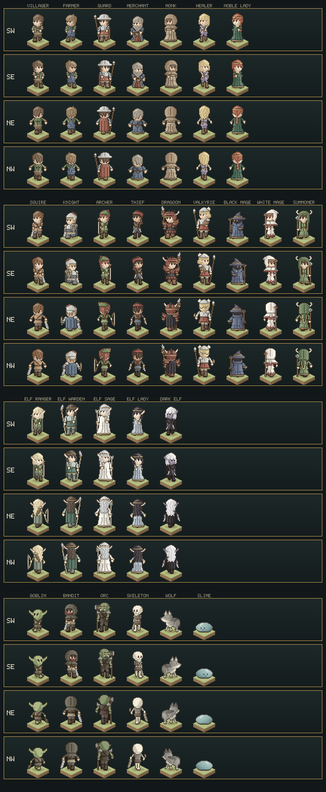

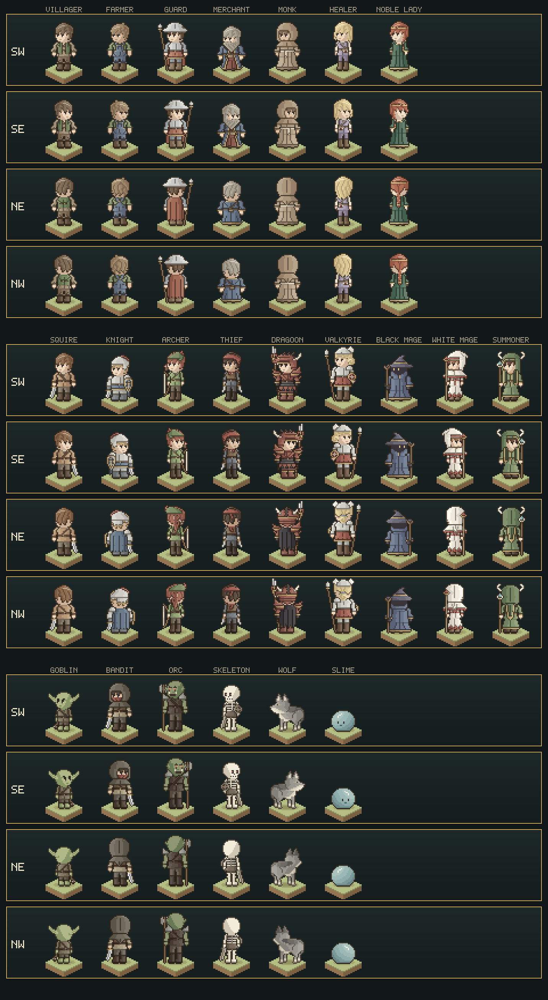

### Unit data

How each character and enemy plays lives in data files, one per unit, kept apart from how they look:

```
data/units/
  characters/  archer.json  blackmage.json  dragoon.json  ...  (the townsfolk and the jobs)
  enemies/     bandit.json  goblin.json  orc.json  skeleton.json  slime.json  wolf.json
```

A file is named by the unit's id, which is the id of the sprite it plays as, and holds its name, HP, Attack, Range
(how many tiles away it can strike), movement (Move: tiles a turn; Jump: height levels a step can climb or drop). `src/data/units.js`
defines the fields, their ranges and defaults, and normalizes and validates a unit; a sprite with no file, such
as a custom character from the maker, plays with the defaults. The tactical view moves units by their Move and
Jump and shows their HP, Attack and Range; adding a field means adding a line to `FIELDS` there.

**Unit data** in the module rail opens `units.html`, an editor for these files:

- **Cards:** the list of units down the side, filterable, and a card for the picked one: its sprite walking (turn
  it with ⟲ ⟳), name and group, and HP, Attack, Range, Move and Jump listed on the right, each with a bar against the strongest unit.
  Changed values are outlined in brass.
- **Table:** everyone in one sortable grid for balancing numbers side by side, every cell editable.
- **Saving:** changes are drafts until **Save** (`Ctrl+S`), which on the dev server (`npm run dev`) writes the
  files through the Hexwright bridge: `PUT` and `DELETE /__hexwright/units/<group>/<id>`, `GET /__hexwright/units`.
  Every write is normalized, so the files keep one shape. A tactical view open in another tab picks the new
  numbers up straight away. **New unit…** gives a sprite without a unit its own file, starting from the defaults
  or a copy of another unit; moving a unit to the other group moves its file. The built site (GitHub Pages)
  shows the same data read-only, with **Download** for a unit's file.

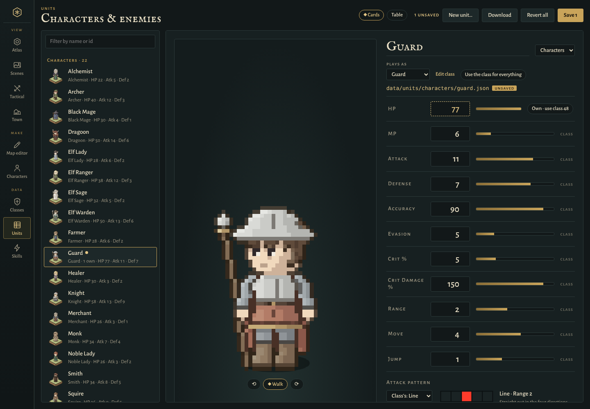

### Tactical view

**Tactical** in the module rail (or `T` in the editor) shows the map through a close-up camera like the old tactics games (Final
Fantasy Tactics, Tactics Ogre): pixel art at whole-pixel zoom (×1 to ×6, about a dozen tiles across by default),
with the camera gliding after the cursor and the unit on the move.

- **Moving units:** click a unit (or press `Tab`) and the tiles it can reach light up in blue, by its own Move and
  Jump from its [unit data](#unit-data) and the editor's walking rules (no more height levels a step than its Jump, around pieces, up and down stairs). The route to the tile
  under the cursor is traced in gold. Click a blue tile (or press `Enter`) and the unit walks there, hopping up
  and down ledges, one stride to a tile at 4.2 tiles a second (8.4 with the ▶▶ 2× chip or F), so the arms swing at the pace the figure moves. The
  camera sits on whole art pixels and rides along the walker's path on the ground (not its hops), holding the
  walker still on screen while the ground scrolls under it. Moves are map edits, on the editor's undo stack.
- **Turns:** a battle runs in turns, each a **player phase** and then an **enemy phase**. The player's side is the
  [unit data](#unit-data)'s characters, the enemy's its enemies. In a phase each unit of that side still standing
  moves once and acts once (Attack, or Wait to give up both); the phase passes on when every one of them is done, or
  at once with **End turn** (`T`). A banner names each new phase and the turn and phase stay in the top bar. In the
  enemy phase the computer plays each enemy in turn: it shows the enemy's range, walks it to where it can strike the
  weakest foe in reach (or as close to the nearest one as it can get, round anything it cannot climb), and strikes;
  the controls wait until it is done, and the ▶▶ 2× chip speeds it up. **Restart** (`R`) starts the battle over: every unit back where it stood
  when the view opened, at full HP, on the player's turn 1 (one map edit, undoable in the editor). Mid-battle it
  asks first: the chip turns to **Restart?** for three seconds and a second press restarts. The actions window opens large, stacked
  on top of the unit's portrait in the bottom corner: a command list naming the unit, each action with an icon and
  what it does (move range, attack power and pattern) or why it is spent. Both windows share a stone-and-gold frame. **Attack** lights the
  red tiles it reaches; picking a foe there opens an **attack preview** in the same row as the unit's portrait: the
  target's own portrait window, the damage on a tag at its corner, and its health bar as the blow would leave it,
  with the hit points it would lose flashing. A crossed-swords clash between the two windows is the **Strike**
  button; picking the target again or `Enter` strikes too, and `Esc` goes back to choosing. The enemy's attacks show
  the same preview while it aims. The battle is won when the last enemy falls
  and lost when the last of yours does. A side with no units on the map has its phase skipped, and on a map of
  enemies only they are yours to move.
- **Attacks:** an attack plays out in the attacker's own frames, and the controls wait until it has.
  - **Melee:** the attacker turns to face its target, winds up and lunges in to strike, and the blow lands with a
    white spark.
  - **Arrows and spells:** the archer looses an arrow that flies to the target on an arc. A staff sends a burst of
    sparks over the target in the caster's colour: fire for the black mage, pale light for the white mage, teal for
    the summoner.
  - **The target:** when the blow lands it flashes white twice and reels back. Only then does the damage rise over
    its head and its health bar drain, and a unit felled fades to a ghost.

  Units keep facing the way they last struck until they walk again. The ▶▶ 2× chip plays attacks at double speed.
- **Camera:** the arrow keys or `WASD` step the cursor along the grid and the camera keeps it in view. Drag to
  pan, scroll or `+`/`-` to zoom, `Q`/`E` to turn the view, `PgUp`/`PgDn` to change storey, `Esc` to go back
  a step (with no unit picked, it takes back the last Wait). `Esc` never leaves the view; **← Editor** does.
  Pieces standing in front of the unit in play or the cursor fade so neither is lost behind them.
- **Panels:** the tile under the cursor (ground, piece, height, storey) and the unit's portrait and stats.
- **Figures:** units are drawn at three quarters of their sprite size, about 30 pixels tall, a little under a
  tile's width. The shrink is done on the sprite's materials before its light and outline are worked out, so it
  stays crisp pixel art with its face intact (`renderScaled` in `characters/roster.js`).
- **Depth:**
  - **Cast shadows:** light comes from the left. Cliffs, walls and buildings throw shadows across the ground to
    their right, and trees throw short ones. Shadow edges follow the ground at a third of a tile.
  - **Occlusion:** ground at the foot of a higher cliff darkens along the edge that meets it.
  - **Elevation:** low ground is a shade darker and high ground a shade lighter, so heights read across a field.
  - **Silhouettes:** a unit hidden behind a building, cliff or tree shows through as an outlined silhouette.
  - **Ordering:** a unit beside a long or wide building is drawn on the correct side of it. It is tested against
    the building's edges, not its centre.

`src/tactical/` holds it:

- **Tile sheet** (`tiles.js`, no DOM). Every ground in the tile set redrawn as pixel art at the characters' scale:
  a 2:1 diamond 32 wide and 16 tall whose rows tile with no gap or overlap, 8 pixels of cliff to a height level,
  so a 32×48 figure stands on it 1:1. Each ground keeps its tile's colours as a five-step ramp and its marks
  (tufts, flowers, furrows, cobbles, boards, carpet borders, ripples) redrawn as pixels, in four variants.
  Cliff faces hang in the tile's two side colours with wandering strata (earth), coursed blocks (stone) or beams
  (wood), and grassy grounds hang a lip over the edge. Water and lava have four frames, and water foams where it
  meets land. Markers: move range, route, target, a two-frame cursor, a pointer and a unit's shadow.
- **Buildings, trees and plants** (`buildings.js`, `foliage.js`, no DOM). Every building and every piece of nature
  in the tile set redesigned as pixel art for the close camera, at the figures' own scale, rather than shrunk
  from the editor's drawings. Each keeps its editor self with the detail a close view can show:
  - **Walls:** plaster with timber framing and braces, coursed ashlar with quoins at the corners, rubble,
    boards and logs.
  - **Openings:** windows with frames, mullions, sills, shutters and a glint on the glass (lit at the tavern),
    and plank doors with hinges and a latch, arched in stone walls.
  - **Roofs and tops:** thatch laid in courses with a stitched ridge and ragged eave, clay tiles, slates,
    shingles and copper; chimneys with caps and smoke; flags, battlements, spires and crosses.
  - **Trees:** broadleaf crowns are lit masses broken into leaf clumps on barked trunks. Pines are drooping
    tiers of needles; the snowy fir has snow along each tier.
  - **Other nature:** palm, dead tree, cactus, reeds, toadstools, wildflowers and rocks.
- **Forge** (`forge.js`, no DOM). The small renderer they are built on: triangles, quads, turned surfaces and
  rounded masses, a depth buffer, per-pixel material shaders over five-step ramps with ordered dithering, and
  finishing that inks the outline and draws a contour wherever one part stands in front of another.
- **Scene** (`scene.js`, no DOM). A map as one back-to-front list of tiles, floors and pieces, each a few sprites
  at art-pixel positions, with figures slotted in by the same depth key. Pieces stand taller than on the editor's
  map, so a cottage is about a figure's height (tall buildings are lifted less, stairs not at all).
- **Renderer** (`render.js`). Draws only what is on screen, at whole device pixels with no smoothing. Buildings,
  trees and plants come from their designs. The smaller props and the furniture are the tile set's own drawings,
  drawn once at one unit to the pixel and finished as pixel art (hard edges, a small palette, an inked rim,
  a dithered contact shadow).
- **Attacks** (`blow.js`, no DOM). An attack's beats (the wind-up, the strike, when it lands, the step back), and
  where everything is at any moment: the attacker's frame and lunge, the arrow or spell, the target's flash,
  knockback and fade.
- **Move range** (`move.js`, no DOM) and the screen itself (`view.js`).

`npm run tactical-sheet` draws the sheet into `docs/images/tactical-tile-sheet.png`. Add `--atlas` for the packed
atlas, `docs/images/tactical-tiles.png`: one row per ground of 32×22 cells (the four variants, the three extra
frames of an animated ground, then a left and right face two levels deep), with the cell map in
`docs/images/tactical-tiles.json`. The sheet also shows every designed building, tree and plant.

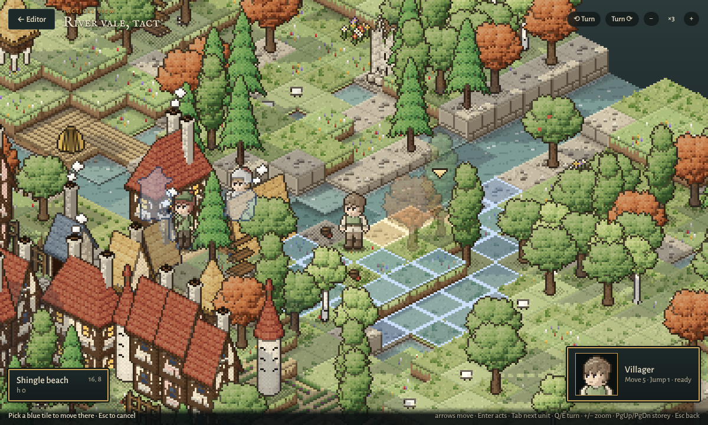

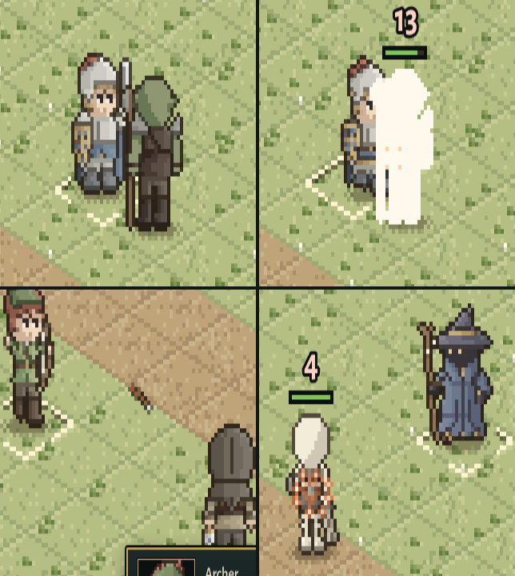

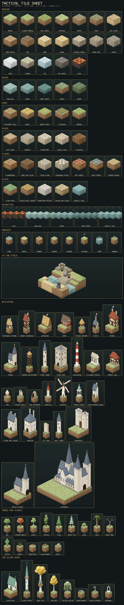

### Town view

**Town** in the module rail (or `O` in the editor) walks the map the way the old town RPGs do (Final Fantasy VI, Dragon Quest, Pokémon):
seen from above and the south on square 96-pixel tiles (about six figures across), with the ground painted as one
solid surface rather than a grid of blocks. Houses fill their tiles at the figures' scale: a door a little taller
than a person, a cottage about twice their height, two-storey houses towering over the street.

- **Solid ground:** every mark (grass tufts, flowers, cobbles, boards, ripples) is laid out in map pixels, so a
  ground runs across tile edges without a seam. Where soft grounds meet (grass, a dirt road, sand, the sea) the border
  wanders on a smooth noise instead of following the grid (a road only gently); paving, floors and fields keep
  straight edges, and paving and roads climb slopes along their length only, so their courses stay straight. The
  higher-ranked ground is inked along its edge and shades the lower one: grass overhangs a path, and the shore shows
  a strip of bank and a line of foam on the water. Water takes its shape from the tiles round it rather than their
  squares, and a chain of water tiles (diagonal steps too) flows as one smooth river. Water and lava ripple.
- **Heights:** height is one continuous surface, 14 pixels up per level, drawn column by column from the south like
  a height-field. Between tiles one level apart (a step anyone can walk) the ground rises in a smooth slope, lit
  where it faces the upper left and shaded where it turns away. Only a jump of two levels or more (where no one can
  walk) breaks into a cliff, its edge wandering like any other border: earth or rock under a ragged grass lip,
  coursed blocks under paving, beams under floors, falling water. Cliffs throw a shadow east and darken the ground at
  their foot.
- **Floors and stairs:** one storey is shown at a time, as in the editor: the ground, or an upper floor on its own
  over the dark, its edge showing as a thin slab. Stairs open the next floor rather than being climbed: step onto a
  flight going up it and the view fades to the floor above, with "Floor 1" in a banner and the hero on the landing at
  the top, in line with the flight. A flight is drawn at the figures' scale, as the furniture is: about a person and a
  half wide and a few strides long, eight treads lighter toward the top between dark stringers. It is set into the
  corner of its tile, hard against the room walls round it (along the east or north wall when its tile has none, the
  foot against a wall where there is one), so stairs always stand in a corner. The floor changes when the hero's feet
  reach the steps heading up them, so walking past beside a flight does not climb it. Up there the way
  down shows as a stairwell the flight's own size, cut in the floor (which runs on round it) behind a banister, its steps
  going down a shade deeper each, in the wood's own browns; walking into it (or clicking it) fades back down to the foot of the flight. Clicking a flight goes up
  it, and a route to a tile on another floor goes by the stairs.
- **Camera:** it follows the hero's place on the ground and, through a gentle smoothing, their height, so climbing a
  ramp or slope never shakes the view.
- **Depth:** every screen pixel of ground remembers which row of the map it shows. A piece or figure is cut away
  wherever the ground shown there lies in front of where it stands, so a rise or cliff hides exactly what is behind
  it, and figures walking up a slope follow the ground.
- **Pieces:** every building, prop, plant and piece of furniture is redrawn front-on. A house fills its own
  footprint, wider than it is tall, seen from the south and a little east: a front wall (plaster, timber framing,
  ashlar, planks) with its east wall receding beside it in shade, both on a stone plinth; a door set back in its
  frame with iron straps, a ring handle and a step, with windows placed symmetrically round it, each set back into
  the wall: the reveal shading the glass along its top and west edge, glazing bars with hairline shadows, the sky
  reflected in the upper panes, a lintel above, a projecting sill with its shadow on the wall, and board shutters
  casting thin shadows; and above, a thatch, clay tile, slate or shingle roof, square along every edge, with a
  capped ridge, a thick eave, its east end in shade, and pale stone chimneys with overhanging caps, a faint shadow on the
  roof and soft smoke. Timber framing shows on the front only: beams three pixels thick standing proud of the wall (lit
  along their tops and west edges, grained, dark underneath), each casting a shadow into the lime-washed plaster
  panels, while the plain shaded east wall keeps the house's depth. Clay tiles are curved, each course shading the
  one below. Roofs keep one pitch, about four tenths of
  the house's depth (steeper for thatch), with the wall fitted below; a two-storey house on one tile takes a lower
  pitch so both storeys keep their full height. So a row of houses never
  covers the fronts of the row behind it; only towers, keeps and spires stand up over the tiles to their north. Round
  towers carry cones or battlements, broadleaf trees are a few big lobes of leaves, each lit on its upper left as a rounded volume and textured in small
  clumps of leaves (a lit leaf over a darker crease), the lower lobes standing in front and the ones tucked behind them
  in shade, so they part without ink; the colours are the tiles' own tree colours on the tiles' gentle ramp, the edges are scalloped
  and soft (the rim a little translucent, a faint halo outside it) rather than cut out, and the trunks are shaded as
  cylinders, their bark broken into plates, flaring into roots, with limbs reaching up into the crown; trees stand a
  little off the grid so a wood never grows in rows; the willow is one bell of hanging strands lit over its crown, a
  darker curtain behind its trunk and the front one parting round it;
  pines are tiers of slanting needles with drooping tips, and props and furniture keep the figures' scale in the
  middle of their tiles. Furniture is built of solid blocks raised to their real heights (a seat at a knee, a table at
  a hip, a wardrobe over a head), each with a lit top grained the way the piece runs, a face toward the viewer and a
  dark sliver of its east side, under a soft shadow: a bed with posts, a quilt in squares under a turned-down sheet and
  a pillow; tables set with jugs, mugs, plates and a loaf; slatted chairs; a three-legged stool; an iron-bound chest; a
  wardrobe of panelled doors; a bookshelf of books of every height and colour; a dresser of drawers with a jug and
  washbowl on it; a desk with paper, a book and a quill; a panelled bar counter with tankards; a cooking pot hung over
  embers from a tripod; a coopered wash tub; a candle stand glowing; a potted fern; a gilt and velvet throne on its
  dais; an altar under a cloth; pews with carved ends; a weapon rack of spears, swords and a shield; and a spinning
  wheel; a coat stand with a cloak and a hat, grain sacks, a crib of firewood and a notice board of pinned bills.
  The tavern's pieces fill their whole tile at the figures' scale: a bar counter of raised panels under a polished
  top, a brass foot rail and stools along its customers' side and tankards, a jug and coins on it, its pieces joining
  into one counter that stands toward the back of its tiles (so the innkeeper's lane behind it stays a stride wide)
  and runs on to a wall at a free end (stopping at the worktop of a back bar against it); a table with up to six slatted chairs pulled up round it; a long trestle table
  set for a feast between two benches; a back bar of bottles and pewter over a panelled cupboard and a rack of casks
  with brass taps, both set back against the wall behind them. The smithy's forge and the alchemist's workbench fill
  their tiles the same way and stand back against the wall: the forge's coals glow hottest at the heart under a fire
  whose light spills over the floor, and the bench carries its alembic, retort, phials, mortar, book and candle under a
  shelf of jars. The smaller pieces meant for a wall (shelves of potions or books, apothecary drawers, herb and tool
  racks, a weapon rack, an armour stand, coal and bar iron, a quenching trough, a wardrobe, a dresser, a desk, a chest,
  a bed or a cot) stand back against a room wall behind them (north, west or east) instead of at the front of their
  tile, and are walked round where they stand. Walls carry a shelf of plates, antlers, a painted
  shield over crossed swords or a sconce whose candle warms the plaster. Each is drawn facing south and turned to its facing, so a turned piece shows its side (a plain face there
  is a framed, sunken panel) and from behind its back. Shadows fall to the east. City and room walls join their neighbours. A room wall running across the view shows its face (a timber beam along
  its top, lime plaster, a skirting board) under its capping beam; one running up the view shows its capping beam and
  its east face in shade, so it reads as a wall rather than a crack; where walls join there is no seam. A doorway is an
  opening in its wall, the wall going on either side, with timber jambs, a lintel carrying the capping beam over it and
  a sill underfoot; only the opening can be walked through. A fireplace is a stone chimney breast built out from its
  wall: an arched firebox with a keystone lintel, firedogs and logs, a fire whose flames and sparks flicker as the view
  runs, a glow on the hearthstone, and a mantel with candlesticks and a jug; the breast blocks the hero as the wall
  does. A piece standing in
  front of the hero fades so they are never lost behind it.
- **Walking:** the hero walks freely, not tile by tile: the arrow keys or `WASD` (diagonals too, `Shift` runs) move
  them at a figure's pace, about three of their own heights a second, with a stride every few pixels so the feet plant
  instead of gliding. Clicking a tile walks them there along the editor's walking route, up and down stairs. `Tab` (or **Next hero**)
  walks as the next character. Everyone else strolls about near where they were put, keeping out of doorways and off stairs; enemies hold their
  ground. Whoever stands in the way of the hero's route steps aside, so routes are planned through people.
- **Collision:** each piece blocks only the ground it is drawn standing on: a tree its trunk, a bush, well or
  haystack its round base, a house its walls (the doorstep stays open), a fence a strip along its rails, an interior
  wall its band, joined to its neighbours. Flowers, toadstools, reeds, doorways and stairs block nothing. Water stops
  the hero exactly at its painted edge, a cliff wherever the ground jumps two levels or more, and other walkers by a
  small circle round their feet. Blocked one way, the hero slides along the other and eases round trunks and corners
  (`src/town/collide.js`).
- **Going indoors:** a building given an interior in the editor (see [Building interiors](#building-interiors)) can
  be entered in three ways: walk into its front door, click the building, or press `Space` facing the door. The view
  goes into the room (see **Transitions**), names it in a banner, and shows it in the top bar after the town's name. The hero comes in just
  inside the doorway, and anyone placed in the room is there, strolling about. They go back out through a doorway in the
  room's outer wall: walk out through it, click it, or use `Esc` or **Leave building**. They come out on the doorstep. A
  room keeps its people where they were left until the view closes. Opened from the editor while a room is open, the
  walk starts in that room.
- **Transitions:** going through a door, taking the stairs, or opening the view, the screen fades to dark and the new
  place is swapped in behind it. It fades back up only once the ground in sight is painted and the pieces in sight are
  fitted to it, all of it done a piece at a time by the painters, so no frame stalls and the place being left never
  shows through. Meanwhile the hero walks in place over the name of where they are going (seen from behind going in or
  up, from the front coming out or down), over three gold lights rising in turn.
- **Talking:** `Space` or `Enter` talks to whoever the hero faces, or to whoever stands across a bar counter the hero faces (they turn to answer, in a slate and gold window with their portrait, like the tactical view's),
  or looks at the piece or water in front of them. Clicking a character walks up to them and talks.
- **Phones and tablets:** a finger dragged anywhere on the map is a stick the hero walks by (a small pull strolls,
  pulled further they run, and the stick follows a finger dragged past it); a tap walks them to the spot or up to
  whoever is there, a tap on the hero or the **Talk** button talks, a tap closes what was said, and two fingers pinch
  the zoom. The page under the view never pans, zooms or selects text.
- **Sharp and smooth:** the canvas has one pixel per device pixel and every art pixel is a whole number of them, so
  the pixel art never smears or shimmers at any screen density; the camera and walkers move to the nearest device
  pixel, so they glide rather than stepping an art pixel at a time. The ground is painted in workers ahead of the
  camera, nearest first, so walking never waits on a new piece of ground coming into view.
- **A stroll, not an edit:** the town view walks a copy of the map, so nothing it does changes the map or its undo
  history, and it starts afresh each time it is opened.

`src/town/` holds it: `ground.js` builds the height surface and paints it in 128-pixel chunks with their depth
buffers (no DOM), `ground-worker.js` runs that painting in a worker, `pieces.js` draws the pieces (no DOM), `elven.js` the elven wood's, `talk.js` holds the lines, and `view.js` is the screen. `scenes/town/saltmere-harbour.html` opens straight
in it.

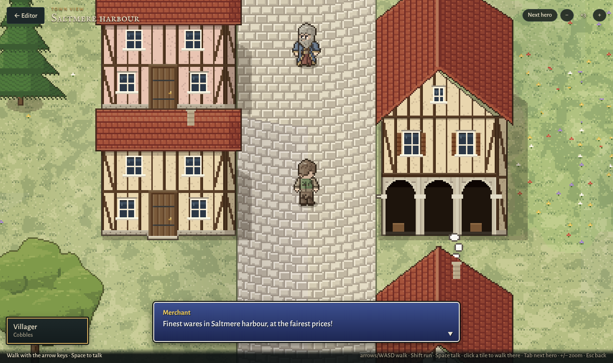

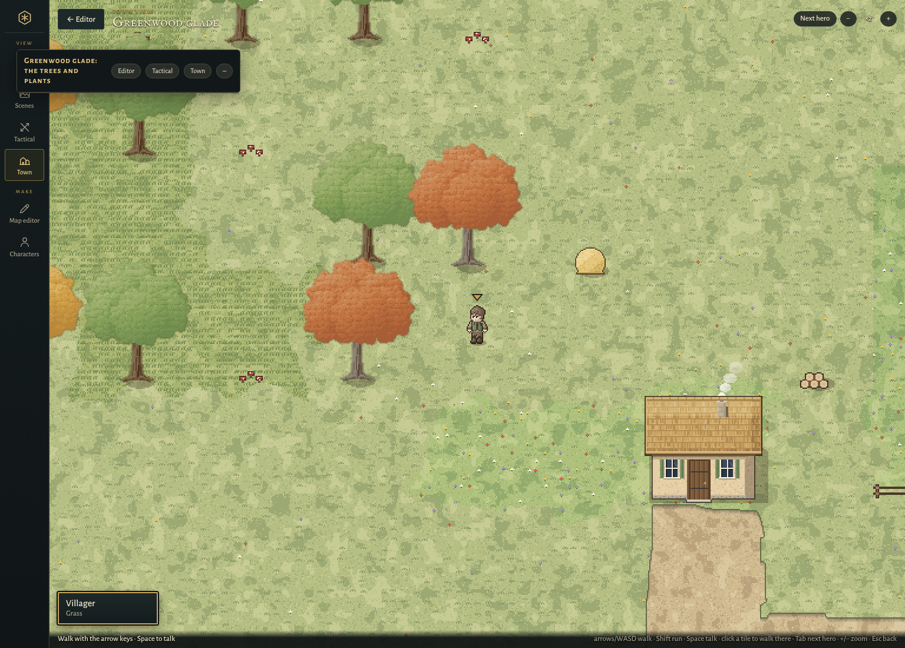

### Test scenes

`scenes/` holds self-contained HTML test pages. Each one is the whole app inlined into a single file that
opens straight from disk, with no server. It has a tile map preloaded in the editor and a panel of walking
checks that run on load. `scenes/hillside-tower.html` is the hillside scene: a terrace reached by one ramp
tile, a three-level tower joined by two flights of stairs, a summit ringed by cliffs, and a two-storey house.

- **Checking routes:** each check walks a character through the automation API and audits the route. Every
  step must be one tile and at most one height level of climb, and storeys may only change on stairs. The page
  shows pass or fail, with the route's step count, heights and storey changes. **Re-run** repeats the checks,
  and clicking a check replays that walk on screen.
- **Scripted browsers:** results are in `window.__sceneResults`.
- **Editor, tactical and town views:** every scene page has all three. The panel's **Editor**, **Tactical** and
  **Town** buttons switch between them, and what is edited in the editor shows in the tactical view when it is opened again.
- **Tactical scenes:** `scenes/tactical/` holds pages that open straight in the tactical view.
  `scenes/tactical/scale-study.html` stands every kind of house, tower and tree on a flat green, with a figure in
  front of each, to judge their sizes against each other. Its map is `scenes/tactical/scale-study.json`, and
  `scale-study.scene.json` beside it gives the title, notes and the camera (`view: "tactical"`,
  `tactical: { zoom, center }`); a scene with nothing to check needs no checks file.
  `scenes/town/saltmere-harbour.html` opens in the town view (`view: "town"`, `town: { zoom, hero }`), an island
  harbour town to walk about in. `scenes/town/greenwood-glade.html` shows off the trees and plants: an oak grove with
  copper beeches, a birch copse on the heath, a poplar avenue, pines climbing a hill to snowy firs, and a reed-fringed
  pond fed by a stream, round a woodcutter's cottage. Its map is built by `node tools/make-greenwood.mjs`.
  `scenes/town/silverleaf-hollow.html` is the elven wood: a moonstone court round a moonwell, the elven hall and spire,
  a domed rotunda, archways over the paths in, a manor in the western wood, a pavilion by the pool, flets in the great
  trees, mallorns on fallen gold leaves and silver willows over a moonlit pool, with the four elves
  about the court and two dark elves creeping in from the west. Its map is built by `node tools/make-silverleaf.mjs`.
  `scenes/town/wayfarers-rest.html` is a fully furnished interior: a village inn that the scene opens inside
  (`town: { inside: { x, y } }` in its `.scene.json` starts the walk in the building on that tile). Downstairs a
  tavern's common room: an aisle from the door to the fire, two tables with their chairs on a red rug at the hearth,
  more tables and long tables between benches, and the bar: a counter with stools along it, the innkeeper's lane behind
  it with the back bar against the wall and a rack of ale casks, closed in by a side counter at its end. A coat stand, a notice board,
  sacks and barrels stand by the door, antlers, a shelf of plates and a sconce hang on the walls, and the stairs stand
  in the corner. Upstairs a passage with sconces and a shield on its partition, and two guest rooms on their carpets.
  The innkeeper, a healer, a guard, a monk, a farmer, a villager and a noble guest are about, and the door leads out
  to a cobbled lane, where two shops stand either side of the inn, each with its interior. West of it the
  **alchemist's shop**: a timbered house of lilac plaster under indigo slate with a turret and its gold star, a window
  of glowing bottles and coloured fumes from the chimney; inside, on a dark oak floor, two workbenches of apparatus and
  shelves of potions against the back wall, apothecary drawers and a herb rack on the west wall, a bubbling cauldron,
  the alchemist, and stairs up to a study with a star chart. East of it the **smithy**: a stone workshop whose forge
  bay stands open to the lane, glowing; inside, the forge with its bellows between coal and bar iron and a quenching
  trough, hammers and tongs on the walls, the anvil with the smith beside it, a weapon rack, an armour stand and a
  grindstone. Its map is built by `node tools/make-wayfarers-rest.mjs`.

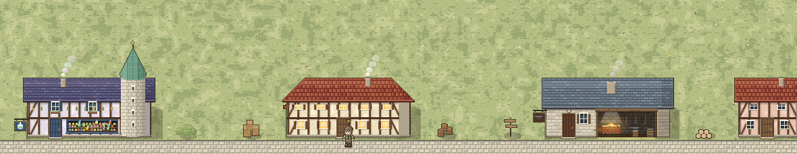

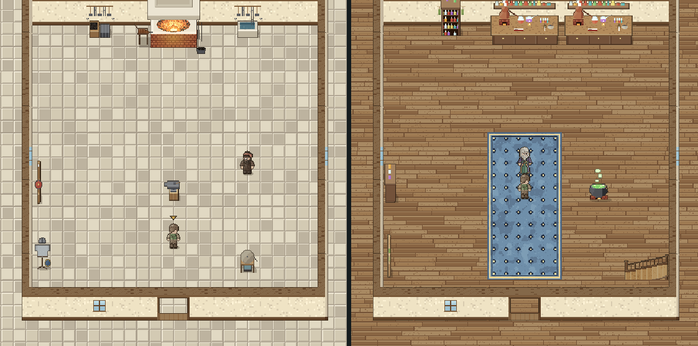

  `scenes/tactical/market-day.html` is a village market square on market day: merchants at their stalls,
  villagers round the well and farmers in the wheat and by the hay cart, in several facings so the backs of their
  clothes show, with the dragoon and the black mage beside them as the benchmark.
- **Rebuilding:** run `npm run scene -- <map.json> [out.html]` to rebuild a page from a saved map
  (`npm run scene -- scenes/tactical/scale-study.json scenes/tactical/scale-study.html` for the scale study). The checks
  come from a `<map>.checks.json` beside it, if there is one; see `src/editor/fixtures/hillside-tower.checks.json`
  for the format. The same scene is replayed by `src/editor/scene.test.js` under `npm test`.

## Automation API and MCP server

The tile editor can be driven without a mouse or Playwright. Three layers share one method list
(`src/editor/api-spec.js`):

1. **In the page**: `window.hexwright.call(method, params)` (also `hexwright.paint(...)` and so on). It
   works in the dev server, a preview build and the deployed site, and edits land on the editor's own
   undo stack through the same operations (`src/editor/ops.js`) the mouse tools use.
2. **HTTP, under `npm run dev`**: a Vite plugin (`tools/vite-hexwright.js`) relays calls to the browser
   page that has the editor open.

   ```
   GET  /__hexwright/pages            connected editor pages
   GET  /__hexwright/spec             every method with its JSON schema
   POST /__hexwright/api/<method>     body = params -> { ok, result } | { ok: false, error }
   ```

   ```sh
   curl -s -XPOST localhost:5173/__hexwright/api/paint -d '{"terrain":"sand","rect":{"x":2,"y":2,"w":4,"h":3}}'
   ```
3. **MCP server** (`mcp/server.mjs`, registered in `.mcp.json`): one `hexwright_<method>` tool per method.
   It uses the dev server at `HEXWRIGHT_URL`, else one already on port 5173 (`127.0.0.1` or `[::1]`, preferring
   the one with an editor page attached), else it starts Vite on a free port. Which browser hosts the page is
   set by `HEXWRIGHT_BROWSER` (in `.mcp.json` `env`) or a `--browser=<mode>` argument:

   | Mode       | Behaviour |
   | ---------- | --------- |
   | `auto`     | Default. Drives the editor tab you have open; with none, starts a headless Chromium. |
   | `browser`  | Only your own browser: edits appear live in your tab. Never launches Chromium (`none` is an alias). |
   | `headless` | Always a private headless Chromium; calls go only to its page, never to your tabs. |

   `HEXWRIGHT_HEADED=1` shows the launched window, `HEXWRIGHT_CHROME` points at a specific binary. The browser
   only hosts the page; no clicks are scripted. Headless needs a Chromium: `npx playwright-core install chromium`.

Methods, all in model tile coordinates (x east, y south):

| Group    | Methods |
| -------- | ------- |
| Discover | `describe` (terrain, assets, biomes, limits), `state`, `ascii` (text map), `getTile`, `getRegion`, `listObjects`, `listSprites`, `listCharacters`, `getMap` |
| Edit     | `paint`, `fill`, `elevation`, `place`, `erase`, `moveObject`, `removeFloor`, `placeCharacter`, `walkCharacter`, `removeCharacter`, `useTool` (a drag path), `batch` (atomic, one undo step), `rename` |
| Interior | `enterInterior` (open a building's interior, giving it one first; every other method then works on the room), `leaveInterior` (back to the map; `remove: true` takes the interior off) |
| Map      | `newMap`, `generate`, `setMap`, `undo`, `redo` |
| View     | `open`, `close`, `setView` (rotation, zoom, centre, grid), `setSelection`, `tileToScreen`, `screenToTile` |
| See      | `screenshot` (`map`: offscreen render at any scale, rotation or tile crop; `viewport`: the on-screen canvas) |

Bad ids and ranges are rejected with a message that names the problem (`unknown terrain "sandd". Did you
mean sand?`), unknown parameter names are rejected, and a placement that does not fit returns
`{ placed: false, reason }` instead of failing silently.

`npm test` runs the unit tests for the pure operations. `npm run test:e2e` drives the whole chain
(MCP client, server, dev server, headless Chromium) and needs a Chromium: set `PLAYWRIGHT_BROWSERS_PATH`
or run `npx playwright-core install chromium`. `E2E_OUT=<dir>` saves the screenshots it takes.

`npm run perf` (after `npm run build`) clicks through the tile editor's tools on a 48×48 map in
headless Chromium and reads the browser's Event Timing entries, the numbers Interaction to Next Paint
is built from. It fails when an interaction's p75 latency passes 200 ms, or when the map image the
editor patched in place after those edits differs by a single pixel from a full render. CI runs it on
every pull request. `PERF_BUDGET_MS`, `PERF_SIZE` and `PERF_CPU_THROTTLE` adjust it.

## Scripts

| Command           | What it does                    |
| ----------------- | ------------------------------- |
| `npm install`     | Install dependencies            |
| `npm run dev`     | Start the Vite dev server       |
| `npm run build`   | Production build into `dist/`   |
| `npm run preview` | Serve the production build      |
| `npm run lint`    | Lint `src/`, `tools/`, `mcp/`   |
| `npm run scene -- <map.json>` | Build a self-contained HTML test page for a scene into `scenes/` |
| `npm run sheet`   | Draw the character sprite sheet and walk into `docs/images/` |
| `npm run tactical-sheet` | Draw the tactical tile sheet (and with `--atlas` the tile atlas) into `docs/images/` |
| `npm test`        | Unit tests (no browser needed)  |
| `npm run test:e2e`| MCP end-to-end test (Chromium)  |
| `npm run perf`    | Editor latency budget (Chromium)|
| `npm run mcp`     | Run the MCP server on stdio     |

Requires Node 18+.

## CI and hosting

`.github/workflows/ci.yml` lints and builds every pull request and every push to `main`. Pushes to
`main` also publish `dist/` to GitHub Pages at <https://shuyi56.github.io/hexwright-atlas/>. Pages
must be set to **Source: GitHub Actions** once, under the repository's Settings → Pages.

## Layout

```
index.html            App shell (markup + font links)
src/
  main.js             Boot: wires up the app and loads the first realm
  styles/main.css     All styles
  core/               Hex geometry, seeded RNG + noise, name generators
  world/              Biome data and the realm generator (terrain, rivers, settlements)
  render/             Canvas painting of the realm map
                      (relief, trees, terrain, settlements, rivers/roads, base compositor)
  city/               City districts: generation, architecture solids, 2.5D rendering
  tiles/              Shared isometric tile set: terrain tiles, buildings, props and nature,
                      drawn procedurally with a small iso kit (used by the city view and the editor)
  characters/         Characters: pixel engine, body builds, shared parts, the townsfolk and the jobs, drawing
                      them on the map, the sprite sheet layout and its pixel font
  data/               Unit data: the fields and ranges of a unit's stats, and the registry the game reads
  units/              The unit data page (units.html)
  battle/             The battle in the tactical view: sides, hit points, turns and the player and enemy phases
                      (state.js), and how the computer plays an enemy (ai.js); pure, no DOM
  tactical/           Tactical view: the pixel tile sheet, the scene as a depth-sorted sprite list, the
                      whole-pixel renderer, move ranges and the close-up camera screen
  town/               Town view: the painted height surface with its slopes, cliffs and depth buffer, the
                      front-on pieces, townsfolk's lines and the walking screen
  editor/             Tile editor: map model, pure ops, renderer, scene generator, city and hex import, UI,
                      automation API (api-spec, api, bridge)
tools/                Vite plugin that relays HTTP calls to the editor page and saves unit data (dev server only),
                      the character sheet writer and a minimal PNG and APNG encoder
data/units/           One JSON file per character and enemy: HP, Attack, Range, Move, Jump
mcp/                  MCP server, backend launcher and end-to-end test
  ui/                 Shared state, map drawing, view/pan/zoom, input, ledger panel, city view, the module
                      rail (rail.js) and the shell that moves between modules and lists the scenes (shell.js)
legacy/               The original single-file artifact, kept for reference
```

`src/ui/state.js` holds the mutable view state (`state.z`, `state.ox`, `state.map`, ...) that the
UI modules share.
